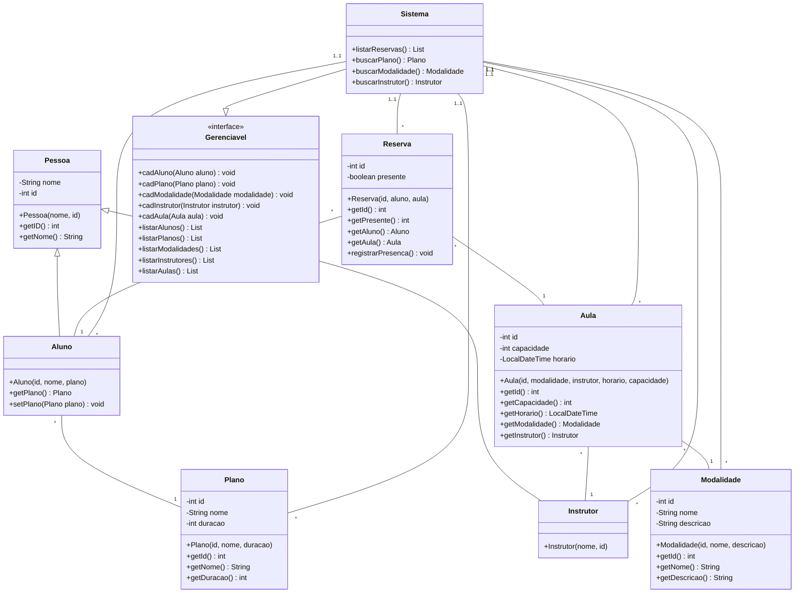

# Força Livre Manager

Sistema para auxiliar o box de treinamento funcional **Força Livre** a controlar alunos, planos, aulas, reservas e presença.

Projeto desenvolvido por Edson Mendes e Igor Santos na disciplina Linguagem de Programação Orientada a Objetos.

## Requisitos funcionais
- Cadastrar aluno
- Consultar plano
- Cadastrar modalidade
- Cadastrar Instrutor
- Cadastrar aula
- Listar alunos
- Listar planos
- Listar cadastros

## Diagrama de classes

