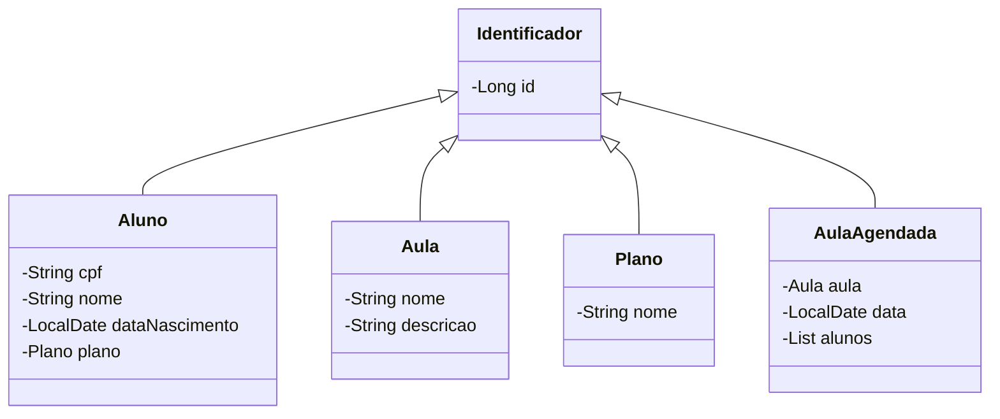

# Força Livre Manager

Sistema para auxiliar o box de treinamento funcional **Força Livre** a controlar alunos, planos, aulas, reservas e presença.

Projeto desenvolvido por Edson Mendes e Igor Santos na disciplina Linguagem de Programação Orientada a Objetos.

## Funcionalidades para o usuário
- Cadastrar aluno
- Consultar plano
- Listar alunos
- Listar planos

## Funcionalidades internas da aplicação
- Carregar Alunos de um arquivo
- Carregar Planos de um arquivo
- Carregar Aulas de um arquivo

## Regras de negócio

##### Aluno
- Alunos não devem possuir mesmo **id**.
- Alunos não devem possuir mesmo **cpf**.

##### Aula
- Aulas não devem possuir mesmo **id**.

##### Plano
- Planos não devem possuir mesmo **id**.

##### Aula Agendada
- AulaAgendadas não devem possuir mesmo **id** 

## Definições
- Entidades são guardadas em arquivo .csv
- Um arquivo para cada entidade a ser persistida

## Classes

